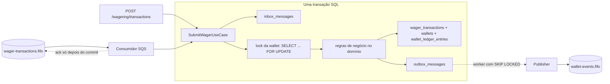
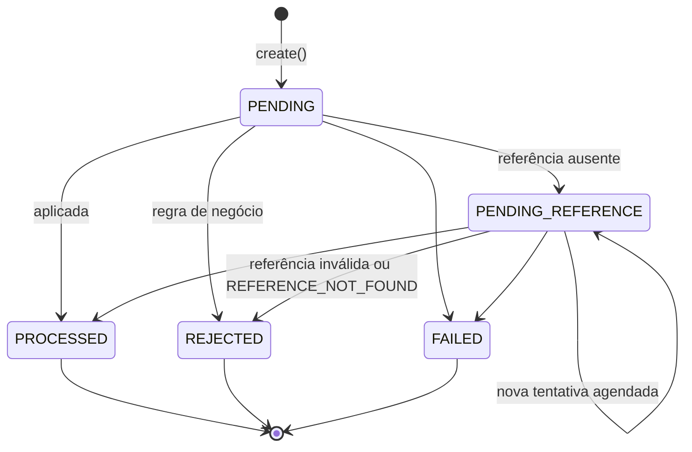

# Arquitetura e decisões

Este documento explica como o serviço garante as invariantes do desafio (sem crédito ou débito duplicado, sem saldo negativo, sem evento confirmado perdido) e por que cada decisão foi tomada. As limitações conhecidas estão no fim, na seção [Limitações e próximos passos](#limitações-e-próximos-passos).

## Visão geral

Uma única regra guia o desenho: **o PostgreSQL é a fonte da verdade, e toda mudança de dinheiro acontece numa única transação SQL** que grava, juntas, a transação de aposta, o novo saldo, o lançamento no ledger, o registro de inbox (quando a entrada é SQS) e os eventos na outbox. Nada sai para fora do banco antes do commit.



Se o processo morrer antes do commit, nada aconteceu e o provedor (ou o SQS) reenvia. Se morrer depois do commit, a idempotency key e a inbox transformam o reenvio em replay, e a outbox garante que os eventos ainda serão publicados por qualquer instância.

## Camadas

```
src/
  domain/          regras puras: Money, Wallet, WalletLedgerEntry, WagerTransaction, settleWager,
                   eventos de integração, InboxMessage, OutboxMessage. Sem NestJS e sem ORM.
  application/     casos de uso e portas (interfaces de repositório, Unit of Work, publisher, métricas)
  infrastructure/  MikroORM (records, repositórios, Unit of Work, migrations), SQS, workers, logs e métricas
  interfaces/      bordas: controllers HTTP, filtro de erros, guard de autenticação, consumidor SQS, schemas zod
```

O domínio não importa nada de NestJS nem do MikroORM. Os casos de uso dependem só das portas em `application/ports.ts`; a implementação com MikroORM fica em `infrastructure/persistence`. Tudo é registrado num único módulo Nest (`app.module.ts`), porque é um único deployable; os dois workers são a mesma classe `PollingWorker` com configurações diferentes. As entidades de domínio seguem a regra do enunciado: construtor privado, factories (`create`, `open`, `rehydrate`) e transições explícitas. O repositório lê a linha do banco e chama `rehydrate`, que não revalida transições.

## ORM e mapeamento do dinheiro

**MikroORM**, a opção preferencial do enunciado. Usamos o `EntityManager` de forma explícita: cada caso de uso roda em `em.fork().transactional(...)`, com um fork novo por operação para o Identity Map nunca devolver um objeto antigo, e os locks usam `LockMode.PESSIMISTIC_WRITE` (`FOR UPDATE`) e `LockMode.PESSIMISTIC_PARTIAL_WRITE` (`FOR UPDATE SKIP LOCKED`).

- **Records separados do domínio.** As entidades do MikroORM (`infrastructure/persistence/records`) são definidas com `defineEntity`, sem decorators, e só mapeiam colunas. Os repositórios convertem record ↔ domínio em `mappers.ts`.
- **Não usamos o change tracking do MikroORM, de propósito.** O Unit of Work e o Identity Map do ORM são ótimos para CRUD, mas aqui cada escrita financeira precisa de um SQL exato: `UPDATE` do saldo condicionado à versão, `INSERT ... ON CONFLICT DO NOTHING` na inbox, `FOR UPDATE SKIP LOCKED` na outbox. Por isso as leituras usam `disableIdentityMap` e as escritas usam `insert`/`nativeUpdate`/SQL parametrizado; não existe flush implícito alterando linhas. O que usamos do ORM é a gestão de transação (`em.fork().transactional`), os `LockMode`, o mapeamento de tipos, o QueryBuilder e as migrations. A porta `UnitOfWork` da aplicação é o limite transacional do caso de uso, não o change tracking do ORM.
- **Migrations escritas à mão** com `this.addSql(...)`, cada uma com `down`. Elas são a única fonte da verdade do schema: constraints, índices parciais e triggers ficam lá. Na Etapa 1 a entidade de wallet repetia as constraints. Abandonamos isso porque repetir dezenas de constraints e triggers em dois lugares seria mais arriscado do que ter uma fonte só. As migrations são sempre criadas em branco (`bun run migration:create`); o diff automático do ORM não é usado.
- **Money** vive em duas colunas, `numeric(19,2)` e `char(3)`. O driver devolve o `numeric` como string, e o repositório reidrata com `Money.from`. Nenhum valor monetário passa por `number` em nenhum ponto. Por dentro, o `Money` usa `decimal.js` com precisão de 40 dígitos; o `Decimal` nunca sai da classe.
- **Entrada estrita:** o valor precisa ter exatamente duas casas (`"25.00"`). `"25"` e `"25.5"` são rejeitados, porque o enunciado diz que o valor é "recebido sempre com escala fixa de 2 casas". Também são rejeitados `NaN`, `Infinity`, notação científica, sinal, vírgula e mais de 17 dígitos inteiros (o limite do `numeric(19,2)`). A moeda precisa estar na lista ISO-4217 do runtime (`Intl.supportedValuesOf('currency')`), então `ZZZ` é recusado.
- **Teto de saldo:** um crédito que deixaria o saldo acima de `99999999999999999.99` (o máximo do `numeric(19,2)`) é rejeitado como regra de negócio, `BALANCE_LIMIT_EXCEEDED`, em vez de virar um erro do banco.

## Concorrência

**Lock pessimista por wallet.** O caso de uso trava a linha da wallet com `SELECT ... FOR UPDATE` e só então decide. Quem chega depois espera na fila do próprio Postgres, relê a wallet já atualizada e decide de novo. Como o lock é na linha, wallets diferentes andam em paralelo (não há lock global), e como ele vive no banco vale igual para 1 ou 30 instâncias.

Por que não optimistic locking: a unidade de concorrência é a wallet, e uma *hot wallet* recebe muitas apostas seguidas. Com versão e retry, a maioria das tentativas concorrentes falharia e precisaria de retry, aumentando latência e carga justamente no caso mais disputado. O lock pessimista dura poucos milissegundos e serializa sem desperdício.

Ordem dentro da transação ([`submit-wager.use-case.ts`](src/application/submit-wager.use-case.ts)):

1. inbox (`INSERT ... ON CONFLICT DO NOTHING`) quando a entrada é SQS;
2. busca pela idempotency key, sem lock (caminho rápido para replays);
3. `SELECT ... FOR UPDATE` da wallet;
4. busca pela idempotency key de novo, agora com a wallet travada. Em *read committed* cada comando enxerga o que já foi commitado, então a segunda requisição idêntica encontra a primeira aqui;
5. regras de negócio no domínio (`settleWager`), que alteram a wallet e devolvem o lançamento;
6. `INSERT` da transação, `UPDATE` do saldo com `WHERE version = anterior`, `INSERT` do ledger e da outbox.

Defesas em profundidade, para o caso de um bug no código:

- `CHECK (balance >= 0)` na wallet e no ledger;
- `UPDATE` do saldo condicionado à versão lida;
- `UNIQUE` em `(provider_id, idempotency_key)` e em `(provider_id, external_transaction_id)`. Se duas requisições com a mesma chave mas wallets diferentes passarem juntas (locks diferentes), uma delas estoura `23505`; o caso de uso refaz a operação uma vez e ela vira replay ou conflito 409, nunca um 500. O mesmo vale para duplicatas idênticas apontando para uma wallet inexistente, onde não há linha para travar: quem chega depois encontra a primeira e devolve replay;
- `lock_timeout` de 5 s por transação (`set_config('lock_timeout', ...)`). Estourar vira erro transitório: 503 com `Retry-After` no HTTP e retry com backoff no SQS.

Não há risco de deadlock: cada transação trava no máximo uma wallet, e o único fluxo que trava duas linhas (o worker de referências) usa sempre a mesma ordem, wallet e depois transação, enquanto o caminho HTTP nunca trava linhas de transação.

O cenário obrigatório (saldo 100, duas apostas de 80 simultâneas) termina com uma aposta `PROCESSED`, a outra `REJECTED` com `INSUFFICIENT_FUNDS`, saldo 20 e um único débito. Ele é testado em uma instância e em três processos.

## Idempotência

A idempotência **é** a tabela `wager_transactions`: a linha gravada com a idempotency key entra na mesma transação do saldo e do ledger, então não existe janela em que o dinheiro mudou e o registro de idempotência não. Não há cache em memória.

- **Chave:** o header `Idempotency-Key` (no SQS, `data.idempotencyKey`) é a fonte da verdade, com até 255 caracteres ASCII visíveis. O valor recomendado é `{providerId}:{externalTransactionId}`, mas não é imposto. **A chave vale dentro de cada provedor** (`UNIQUE (provider_id, idempotency_key)`): um provedor não consegue "queimar" nem sondar a chave de outro.
- **`payloadHash`:** SHA-256 em hexadecimal de um JSON canônico, com as chaves ordenadas recursivamente e campos `undefined` removidos, contendo só os campos de negócio: `providerId`, `externalTransactionId`, `playerId`, `walletId`, `roundId`, `gameId`, `kind`, `money` (normalizado por `Money.from(...).toJSON()`) e `referenceExternalTransactionId`. O header e os metadados de transporte não entram. Código em [`payload-hash.ts`](src/application/payload-hash.ts).
- **Replay:** a mesma chave com o mesmo payload devolve o resultado gravado, inclusive o saldo observado naquele momento (coluna `balance_after`), com `idempotentReplay: true`. Isso vale também para rejeições, que são gravadas como `REJECTED` justamente para o replay devolver a mesma rejeição.
- **Conflitos (409):** a mesma chave com outro payload gera `IDEMPOTENCY_KEY_REUSED`; o mesmo `(providerId, externalTransactionId)` com outra chave gera `EXTERNAL_TRANSACTION_ID_REUSED`.
- **HTTP e SQS compartilham a mesma idempotência:** a mesma operação chegando pelos dois caminhos vira uma linha só. A inbox deduplica a *mensagem* (`messageId`); quem deduplica a *operação* é a idempotency key.
- **Toda rejeição é gravada**, inclusive `WALLET_NOT_FOUND` (wallet inexistente ou de outro player). Por isso `wager_transactions.wallet_id` não tem FK. No lugar dela, o trigger `trg_wager_transactions_wallet_exists` só aceita uma wallet inexistente quando a linha é exatamente uma rejeição `WALLET_NOT_FOUND`. Sem isso, um reenvio dessa rejeição não seria replay, e a mesma chave reaproveitada depois com outro payload seria processada em vez de dar 409.
- **Saldo no replay:** o `balance` devolvido é sempre o da wallet, na moeda dela. Quando não há saldo comparável, ele é `null` tanto na primeira resposta quanto no replay: wallet inexistente ou moeda diferente da wallet (`CURRENCY_MISMATCH`).

## Máquina de estados da transação



- `PROCESSED`, `REJECTED` e `FAILED` são terminais. Tentar transicionar a partir deles lança `InvalidTransactionStateError` no domínio, e o trigger `trg_wager_transactions_guard` recusa o `UPDATE` no banco. O mesmo trigger impede alterar os campos imutáveis e apagar linhas.
- `PENDING` só existe em memória: a decisão acontece na mesma transação do `INSERT`, então nenhuma linha é gravada como `PENDING`.
- `FAILED` é produzido pelo worker de referências quando uma transação pendente falha com um erro que não é transitório (o banco recusou a escrita, por exemplo). Ela fica `FAILED` com `PROCESSING_FAILED`, auditável, em vez de ser retentada para sempre e travar o worker. O replay de uma transação `FAILED` responde 422. Mensagens SQS permanentemente inválidas vão para a DLQ sem virar transação.

## Regras de negócio e interpretações

| Operação | Efeito | Ledger | Detalhes |
| --- | --- | --- | --- |
| `BET` | débito | `DEBIT` | rejeitada com `INSUFFICIENT_FUNDS` se faltar saldo |
| `WIN` | crédito | `CREDIT` | referência opcional; se vier, precisa ser uma `BET` da mesma rodada |
| `LOSS` | nenhum | nenhum | referência opcional como no `WIN` |
| `REFUND` | crédito | `CREDIT` | referência obrigatória a uma `BET` `PROCESSED`, mesmo valor |
| `ROLLBACK` | inverso da referência | inverso | referência obrigatória a `BET`, `WIN` ou `REFUND` `PROCESSED`, mesmo valor |

Interpretações adotadas:

- A referência é resolvida por `(providerId, referenceExternalTransactionId)` e precisa ter o mesmo provider, player, wallet, moeda e rodada; senão gera `REFERENCE_MISMATCH`.
- **Uma transação é revertida no máximo uma vez, por `REFUND` ou por `ROLLBACK`.** A regra 4 do enunciado fala "pelo mesmo tipo de operação", mas um `REFUND` seguido de um `ROLLBACK` da mesma `BET` devolveria o valor duas vezes, o que viola "não duplicar créditos". A garantia está no índice único parcial `uq_wager_transactions_single_reversal`. Um `ROLLBACK` de um `REFUND` continua permitido, porque referencia outra transação.
- Uma reversão que deixaria o saldo negativo é rejeitada com `REVERSAL_INSUFFICIENT_FUNDS`, código distinto do `INSUFFICIENT_FUNDS` da aposta, e fica gravada.
- Valores `0.00` são aceitos e processados sem lançamento no ledger, já que o saldo não muda (o ledger só aceita `amount > 0`).
- Uma referência que existe mas ainda não terminou (por exemplo, um `ROLLBACK` de um `REFUND` que está em `PENDING_REFERENCE`) é tratada como ausente: a transação espera.
- Um `WIN` ou `LOSS` que referencia uma `BET` já revertida é rejeitado com `ALREADY_REVERSED`: pagar o prêmio de uma aposta cancelada seria um crédito sem aposta.
- `OPENING` é interno. O provider `internal` é reservado e recusado na API e na fila.

### Referências fora de ordem

Referência ausente grava a transação como `PENDING_REFERENCE` (HTTP 202) e publica `WagerTransactionPendingReference`. Um worker em todas as instâncias busca as vencidas (`next_reference_attempt_at <= now()`) e, para cada uma, abre uma transação, trava a wallet e depois a transação, e roda as mesmas regras.

Política: atraso de 1 s dobrando a cada tentativa, limitado a 5 min, com até 10 tentativas. São cerca de 13,5 min no total (1+2+4+…+256 s+300 s). O limite cobre o atraso típico de redelivery de um provedor, já que filas e retries de provedores costumam operar em segundos a poucos minutos, sem deixar uma transação pendurada por horas. Esgotou: `REJECTED` com `REFERENCE_NOT_FOUND` e evento `WagerTransactionRejected`. Tudo é configurável por variável de ambiente.

## Status HTTP e códigos de falha

| Situação | Status | Corpo | O provedor deve |
| --- | --- | --- | --- |
| Processada agora | 201 | `status: PROCESSED`, `idempotentReplay: false` | Seguir |
| Replay | 200 | resposta original, `idempotentReplay: true` | Seguir |
| Aguardando referência | 202 | `status: PENDING_REFERENCE` | Consultar depois |
| Payload inválido, sem `Idempotency-Key`, JSON quebrado | 400 | `code: VALIDATION_ERROR` + `details` | Corrigir o payload |
| Sem credencial, com autenticação ligada | 401 | `code: UNAUTHORIZED` | Autenticar |
| Provider autenticado diferente do corpo | 403 | `code: PROVIDER_MISMATCH` | Corrigir credencial |
| Recurso inexistente (GET), ou transação de outro provedor | 404 | `code: NOT_FOUND` | — |
| Corpo acima de 100 KB | 413 | `code: PAYLOAD_TOO_LARGE` | Corrigir o payload |
| Mesma chave com outro payload, mesmo id externo com outra chave, wallet duplicada | 409 | `code` específico | Não reenviar; é bug do cliente |
| Rejeitada por regra de negócio (inclusive replay de rejeição) | 422 | `status: REJECTED`, `failureCode` | Decidir pelo `failureCode` |
| Replay de uma transação que falhou de forma permanente | 422 | `status: FAILED`, `failureCode: PROCESSING_FAILED` | Escalar para operação manual |
| Banco indisponível, lock timeout, deadlock | 503 | `code: TRANSIENT_ERROR`, header `Retry-After` | Reenviar com a mesma chave |
| Erro inesperado, inclusive o banco recusando uma escrita que a validação deveria ter barrado | 500 | `code: INTERNAL_ERROR`, sem detalhes | Escalar |

O mapeamento fica num único exception filter global ([`http-error.filter.ts`](src/interfaces/http/http-error.filter.ts)), e o status de sucesso sai do resultado do caso de uso ([`wagering.controller.ts`](src/interfaces/http/wagering.controller.ts)).

| `failureCode` | Quando | Ação do provedor |
| --- | --- | --- |
| `INSUFFICIENT_FUNDS` | `BET` maior que o saldo | Desistir |
| `BALANCE_LIMIT_EXCEEDED` | Crédito deixaria o saldo acima do máximo armazenável | Escalar para operação manual |
| `REVERSAL_INSUFFICIENT_FUNDS` | Reversão deixaria saldo negativo | Escalar para operação manual |
| `REFERENCE_NOT_FOUND` | Referência não apareceu até esgotar as tentativas | Verificar se a original foi enviada |
| `REFERENCE_MISMATCH` | Referência de outro provider, player, wallet, moeda ou rodada | Corrigir payload |
| `REFERENCE_INVALID_KIND` | Tipo referenciado não permitido (ex.: `REFUND` de um `WIN`) | Corrigir payload |
| `REFERENCE_AMOUNT_MISMATCH` | Valor diferente da referência | Corrigir payload |
| `REFERENCE_NOT_PROCESSED` | Referência `REJECTED` ou `FAILED` | Desistir |
| `ALREADY_REVERSED` | Referência já revertida | Desistir |
| `CURRENCY_MISMATCH` | Moeda difere da wallet | Corrigir payload |
| `WALLET_NOT_FOUND` | Wallet inexistente ou de outro player | Corrigir payload |
| `PROCESSING_FAILED` | Transação pendente que falhou de forma permanente ao ser reprocessada (status `FAILED`) | Escalar para operação manual |

## Schema e constraints

As garantias de unicidade, imutabilidade e não-negatividade estão no schema ([migrations](src/infrastructure/persistence/migrations)), e cada uma tem um teste em [`schema.spec.ts`](test/integration/schema.spec.ts).

| Constraint | Garante |
| --- | --- |
| `ck_wallets_balance_non_negative`, `ck_wallet_ledger_entries_balances_non_negative` | Saldo nunca negativo |
| `uq_wallets_player_currency` | Uma wallet por player e moeda |
| `uq_wager_transactions_idempotency_key` (`provider_id`, `idempotency_key`), `uq_wager_transactions_provider_external` | A mesma operação nunca é gravada duas vezes |
| `uq_wager_transactions_single_reversal` (índice parcial) | Uma referência é revertida no máximo uma vez |
| `ck_wager_transactions_reference_required` / `_reference_allowed` | `REFUND`/`ROLLBACK` exigem referência; `OPENING`/`BET` não aceitam |
| `ck_wager_transactions_failure_code`, `_processed_has_balance`, `_terminal_has_processed_at`, `_pending_has_schedule` | Estados coerentes com seus campos |
| `trg_wager_transactions_guard` | Transação terminal não muda; campos financeiros imutáveis; sem `DELETE` |
| `trg_wager_transactions_wallet_exists` | Toda transação aponta para uma wallet existente, exceto a rejeição `WALLET_NOT_FOUND` |
| `uq_wallet_ledger_entries_transaction_wallet` | No máximo um lançamento por transação e wallet |
| `ck_wallet_ledger_entries_arithmetic` | `balance_before ± amount = balance_after` |
| `fk_wallet_ledger_entries_wallet_currency` | Lançamento na mesma moeda da wallet |
| `fk_wallet_ledger_entries_transaction_wallet` | Lançamento pertence à wallet da sua transação |
| `trg_wallet_ledger_entries_immutable`, `trg_wallet_ledger_entries_no_truncate` | Ledger append-only: sem `UPDATE`, `DELETE` ou `TRUNCATE` |
| `pk_inbox_messages` | Mesma mensagem processada uma vez por consumidor |

A coluna `seq` (identity) do ledger dá a ordem estável para o cursor da paginação: o cursor é o `seq` codificado em base64url, opaco para o cliente e validado na volta.

## Eventos de integração

Quatro eventos, cada um uma subclasse de `IntegrationEvent<T>` com `eventType` e `version` no próprio tipo: `WagerTransactionProcessed` (inclusive `LOSS` e `OPENING`), `WagerTransactionRejected`, `WalletBalanceChanged` (somente quando o saldo muda) e `WagerTransactionPendingReference`. O `data` carrega `MoneyProps` (string decimal), nunca a instância de `Money`.

O `aggregateId` de todos é o `walletId`, a unidade de concorrência. Na fila `wallet-events.fifo`, `MessageGroupId = walletId` mantém a ordem por wallet e `MessageDeduplicationId = eventId` reduz duplicatas. A deduplicação do SQS é só uma otimização: o consumidor de eventos precisa deduplicar pelo `eventId`, e o `walletVersion` do `WalletBalanceChanged` permite reordenar.

## Outbox

Os eventos são gravados em `outbox_messages` na mesma transação do saldo, então nenhum evento sai antes do commit. Um worker roda em todas as instâncias:

1. `SELECT ... FOR UPDATE SKIP LOCKED` dos vencidos (lote de 50), para que publishers concorrentes peguem lotes disjuntos sem esperar uns pelos outros;
2. `SendMessageBatch` (10 por chamada);
3. marca `published_at` na mesma transação. Falhas ganham `attempts + 1` e `next_attempt_at` com backoff de 1 s dobrando até 60 s, e nunca são descartadas.

O cenário do enunciado é coberto por teste: o Postgres confirma, o processo morre antes de publicar, outra instância publica. Se o processo morrer **depois** de publicar e **antes** de commitar o `published_at`, o lock é solto e o evento sai de novo. Essa duplicata é segura porque o consumidor deduplica pelo `eventId`.

Trade-off: a transação do lote fica aberta durante a chamada ao SQS. É simples e seguro, mas segura as linhas e uma conexão enquanto o SQS responde. Para um SQS travado não segurar isso indefinidamente, o cliente tem timeout de conexão (3 s) e de requisição (long poll + 10 s), e o desligamento dos workers tem limite de tempo. A alternativa mais robusta é uma coluna de *lease* (`locked_until`): marcar e commitar, publicar fora da transação e confirmar depois. Fica listada como próximo passo. Outra consequência: se uma mensagem de um lote falha e uma posterior da mesma wallet passa, a ordem por wallet na fila pode inverter. O `walletVersion` resolve isso para quem consome.

## Consumidor SQS

O consumidor faz long polling (20 s) na `wager-transactions.fifo` e processa as mensagens em sequência, o que preserva a ordem por grupo. Se uma mensagem de um grupo falha de forma transitória, as mensagens seguintes do mesmo grupo naquele lote são devolvidas à fila sem processar, para não passarem na frente dela. Para cada mensagem:

| Resultado | Classe | Ação |
| --- | --- | --- |
| Processada, rejeitada por regra de negócio ou replay | negócio | `DeleteMessage` (ack) **depois** do commit |
| JSON inválido, schema inválido, `OPENING`, idempotency key reaproveitada, `messageId` reaproveitado com outro conteúdo, banco recusando a escrita por dado inválido (SQLSTATE 22xxx, 23xxx, P0001) | permanente | Envia para a DLQ com o motivo em `deadLetterReason` e dá ack |
| Banco indisponível, lock timeout, erro desconhecido | transitória | Não dá ack; `ChangeMessageVisibility` com 2^n s (n = `ApproximateReceiveCount`), limitado a 300 s |

Depois de `maxReceiveCount = 10` recebimentos sem ack, o próprio SQS move a mensagem para `wager-transactions-dlq.fifo` (redrive). Com o backoff de 2, 4, 8… até 300 s, isso dá cerca de 13 minutos de tentativas para uma mesma mensagem. É o caso de um erro transitório que persiste só para ela, como uma wallet presa num lock longo.

**Uma queda do banco não esgota as tentativas.** Cada recebimento conta para o `maxReceiveCount`. Se o consumidor continuasse recebendo durante uma queda do Postgres, uma queda de pouco mais de um minuto mandaria apostas válidas para a DLQ. Para evitar isso, depois de qualquer falha transitória o consumidor testa o banco (uma transação vazia pelo mesmo Unit of Work) antes da próxima mensagem. Se o teste passar (era só um lock timeout), ele segue normalmente. Se falhar, ele devolve as mensagens restantes do lote com um pequeno atraso e **para de chamar `ReceiveMessage`**, testando o banco com backoff de 1 s até 30 s até ele voltar. Cada mensagem gasta no máximo uma tentativa por queda (uma por instância). A DLQ fica reservada para o que é realmente permanente. Existe teste de unidade desse comportamento em [`wager-queue.consumer.spec.ts`](src/interfaces/sqs/wager-queue.consumer.spec.ts).

A inbox (`inbox_messages`, PK `(consumer_name, message_id)`) é gravada dentro da transação do caso de uso. O caso "worker morto depois do commit e antes do ack" se resolve sozinho: a mensagem volta após o visibility timeout, a inbox registra a duplicata, a idempotency key devolve o resultado gravado e o ack acontece. Há teste com um processo real que morre exatamente nesse ponto (variável `FAULT_EXIT_AFTER_COMMIT_BEFORE_ACK`, aceita só com `NODE_ENV=test`).

**SIGTERM:** `app.enableShutdownHooks()`. No `beforeApplicationShutdown`, o consumidor para de buscar mensagens, aborta o long poll, termina a mensagem em andamento e devolve as recebidas e não iniciadas com `ChangeMessageVisibility 0`. Os workers de outbox e de referências terminam o lote atual. O cliente SQS só é fechado no `onApplicationShutdown`, depois de tudo isso.

## Observabilidade

- **Logs JSON** com `correlationId`, `messageId`, `transactionId`, `walletId` e `providerId`, propagados por `AsyncLocalStorage`. O `correlationId` vem do header `X-Correlation-Id` (aceito só com `[A-Za-z0-9._:-]`, até 128 caracteres; senão é gerado) e volta no mesmo header; no SQS vem do envelope ou do `messageId`. Os logs não incluem payloads nem valores monetários. Erros do driver do Postgres são registrados só com o SQLSTATE e a primeira linha da mensagem, porque o `detail` de uma violação de `CHECK` traz a linha inteira, com valores.
- **Métricas** em `/metrics` (Prometheus): `wager_transactions_total{status,kind}`, `idempotent_replays_total`, `inbox_duplicates_total`, `concurrency_conflicts_total{reason}` (lock timeout, deadlock e corridas de unicidade), `sqs_retries_total`, `sqs_dlq_total{reason}`, `sqs_dlq_messages`, `outbox_lag_seconds`, `outbox_published_total`, `outbox_publish_failures_total`, `pending_reference_attempts_total{outcome}`, `wager_processing_seconds` (histograma) e `reconciliation_mismatches_total`.
- **Health:** `/health/live` não consulta dependências, para que um Postgres fora não derrube todas as instâncias em cascata. `/health/ready` faz `SELECT 1` e `GetQueueUrl`, com timeout de 2 s, e responde 503 se algo falhar.
- **Reconciliação:** `POST /wallets/:id/reconciliation` lê o saldo guardado e soma o ledger **num único comando SQL**. Um comando enxerga um snapshot consistente, então não é preciso travar a wallet, e a reconciliação nunca atrasa apostas. Divergências não são corrigidas: geram log de erro, métrica e `consistent: false`.
- **Exposição:** `/metrics` é para o scraper interno; o nginx do compose não o expõe. No compose, Postgres, MiniStack e a API escutam só em `127.0.0.1`.

## Autenticação

Não implementada, como o enunciado permite, porque não vale pontos e competiria com o núcleo financeiro. O ponto de extensão está no código ([`provider-identity.ts`](src/interfaces/http/provider-identity.ts)) e já se comporta como deve quando uma implementação real for plugada, o que é provado em [`provider-identity.spec.ts`](test/integration/provider-identity.spec.ts) com uma identidade de teste:

- a porta `ProviderIdentityPort` tem um campo `enabled`. Com ele ligado, requisição sem identidade recebe **401**: o guard falha fechado. A implementação atual, `AllowAllProviderIdentity`, declara `enabled = false`;
- o `ProviderAuthGuard` fica nos controllers de wallet e wagering; health e métricas ficam abertos;
- `assertProviderMatches` responde **403** quando o `providerId` do corpo ou da rota difere do autenticado;
- `GET /wagering/transactions/:id` de uma transação de outro provedor responde **404**, para não confirmar que ela existe;
- as idempotency keys já são separadas por provedor.

Desenho proposto: quem chama a API é o sistema de um provedor, não uma pessoa, então o fluxo é **OAuth2 Client Credentials** num IdP externo (Keycloak ou Zitadel no compose):

1. cada provedor é um *client* confidencial com *service account*, e o `client_id` é o `providerId`;
2. o provedor obtém o token com `client_id` e `client_secret` e envia `Authorization: Bearer`;
3. um `JwtProviderIdentity` valida a assinatura pelo JWKS do realm (`jose`: `createRemoteJWKSet` e `jwtVerify`), além de `iss`, `aud` e `exp`, e devolve o `providerId`;
4. a regra de domínio que importa já está pronta: o `providerId` do token tem que ser igual ao do corpo, senão o provedor A lançaria transações em nome do B;
5. mensagens da fila são canal interno confiável e não carregam token, mas passam pelas mesmas validações de referência e de wallet.

Trocar `AllowAllProviderIdentity` por `JwtProviderIdentity` é uma linha no `AppModule`. O que **não** está resolvido é a autorização das rotas de wallet: criar wallet, ler saldo e extrato e reconciliar são operações do operador da plataforma, não de um provedor de jogos. Com autenticação real, elas pediriam um escopo próprio (por exemplo `wallet:admin`), concedido a outro *client*.

## Testes

- **Unidade** (`src/**/*.spec.ts`): `Money` (escala, entradas inválidas, precisão nos limites, `-0`), invariantes da `Wallet` e do ledger, transições terminais, todas as regras de `BET`/`WIN`/`LOSS`/`REFUND`/`ROLLBACK`, conflito de moeda, política de retry, `payloadHash` (ordem de chaves, payload divergente).
- **Integração** (`test/integration`), contra Postgres e MiniStack reais: migrations reversíveis, cada constraint e trigger, atomicidade (do Unit of Work e do caso de uso real, com uma falha injetada no último `INSERT`), API e status HTTP, idempotência (inclusive escopo por provedor), referências fora de ordem com o worker e transação "venenosa" indo para `FAILED`, outbox (dois publishers concorrentes, retry, outra instância assumindo), consumidor (inbox, redelivery, HTTP e SQS com a mesma chave, DLQ, retry, redrive), entradas maliciosas, autenticação ligada, logs, métricas e health.
- **Concorrência** (`test/concurrency`), com paralelismo real: os oito cenários da seção 13 do enunciado, sendo os de múltiplas instâncias, crash, SIGTERM e reinício feitos com processos `bun src/main.ts` de verdade; mais corridas da mesma chave em wallets diferentes e a prova de que o lock é por wallet (uma wallet travada não atrasa outra).
- **Invariante final** (`expectReconciled`): em todos os testes que movem dinheiro, o saldo é igual à soma do ledger e ao `balance_after` do último lançamento.

Cada execução recria o banco `wallet_test` (ou o nome em `TEST_POSTGRES_DB`) com as migrations e usa filas com nome único. Os testes não limpam tabelas (o ledger não deixa): cada um cria suas próprias wallets. A suíte passou três vezes seguidas antes da entrega.

**Validação por mutação.** Para saber se os testes realmente protegem as garantias, e não só passam, cada garantia importante foi quebrada de propósito numa cópia do projeto, e conferimos que algum teste falha. Foram 42 mutações em duas rodadas, entre elas:
- remover o lock da wallet (com e sem a checagem de versão);
- remover a segunda checagem da idempotency key e o retry após violação de unicidade;
- dar ack antes do commit e remover a inbox;
- remover a checagem de reversão única, a de moeda, a do teto de saldo e o lançamento no ledger;
- tirar o lock da outbox, trocar `SKIP LOCKED` por `FOR UPDATE` e marcar falhas como publicadas;
- remover o `lock_timeout` e injetar um lock global em toda transação;
- remover o `CHECK` de saldo e o trigger do ledger;
- tirar campos do `payloadHash`, desligar o disjuntor do consumidor, a ordem do grupo FIFO e a devolução de mensagens no SIGTERM;
- deixar o readiness sempre "ok", remover os campos de contexto dos logs e o eco do `X-Correlation-Id`;
- abrir a autenticação, a checagem de provedor e a de dono da transação;
- remover a escala de `FAILED`, o escopo de provedor da chave, a validação de texto e as métricas de replay e de lock.

Na primeira rodada, 9 dessas quebras passavam despercebidas. Para cada uma foi escrito um teste, e hoje **todas são pegas pela suíte**.

## Limitações e próximos passos

- **Vazão limitada por CPU em cada instância.** No notebook usado, uma instância processa cerca de 145 req/s com a CPU do processo saturada; o banco não é o gargalo (nenhum lock timeout, que apareceria como 503). Escala horizontal funciona por design, mas o ganho medido com 3 instâncias no mesmo notebook foi pequeno, porque gerador, banco e instâncias disputam os mesmos núcleos. Detalhes em [docs/LOAD_TEST.md](docs/LOAD_TEST.md).
- **Hot wallet segura conexões.** Requisições esperando o lock de uma wallet disputada ocupam conexões do pool e aumentam a latência das outras. Próximos passos: limitar a concorrência por wallet antes do banco (fila em memória por instância ou roteamento por `MessageGroupId`) e separar o pool dos workers.
- **Outbox sob carga contínua.** O publisher divide a CPU com as requisições, e o lag cresce durante picos, esvaziando depois. Próximos passos: instâncias dedicadas só a publicar (`OUTBOX_PUBLISHER_ENABLED`) e a coluna de *lease* para não segurar a transação durante a chamada ao SQS.
- **Retenção.** `inbox_messages` e as linhas já publicadas da outbox crescem sem limite; falta um job de limpeza com janela maior que o tempo máximo de redelivery.
- **Uma queda do banco ainda custa uma tentativa por mensagem e por instância** (a que descobre a queda). Com muitas instâncias e uma queda longa, uma mensagem que já estivesse perto do limite poderia ir para a DLQ. Um disjuntor compartilhado entre as instâncias resolveria isso.
- **Credenciais do banco.** A aplicação conecta como o dono das tabelas. Os triggers de imutabilidade protegem contra bugs, mas quem tem essa credencial consegue desligá-los (`session_replication_role`). Em produção: um role dono do schema usado só nas migrations e um role da aplicação com `SELECT`/`INSERT` no ledger e sem `UPDATE`/`DELETE`.
- **Sem rate limiting.** Toda requisição válida grava uma linha (inclusive rejeições, para manter a idempotência). Um limite por provedor no gateway resolveria o abuso.
- **Fora do escopo:** autenticação real, reversão parcial, ledger de partidas dobradas e OpenTelemetry.
- **Records só mapeiam colunas.** Não há checagem automática de que as entidades do ORM batem com o schema; os testes de integração exercitam todas as colunas, mas um teste dedicado de "schema em sincronia" seria mais explícito.
